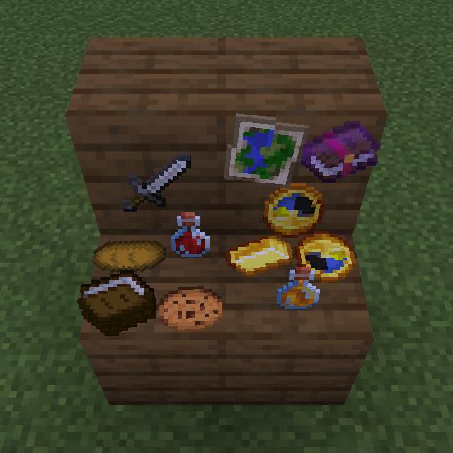

# Knick Knacks

Set a loaf, a book or a potion down on a table, a shelf or the floor, and it stays there.

## Screenshots

A room is furniture and then everything on the furniture: a loaf on the counter, a book left out, a compass on the desk. Vanilla gives the furniture and none of the rest, so a table stays bare however well it is built.

## Setting Something Down

Hold the thing in your **off hand**, **sneak**, and **right-click a block with an empty main hand**: its top, its side or its underside. One of it leaves your hand and lies where you clicked.

- **Food, potions, books, tools, gems, a clock, a compass**: most lie flat, face up, the way you would put a book down. **Bottles and flowers stand**: potions, honey, a bottle o' enchanting, an empty glass bottle, a poppy, a cornflower.
- **Vanilla goes first.** Whatever the thing would have done to that block, it does: a candle is placed as a candle, a lantern as a lantern, an axe strips a log, bone meal grows the grass, a carrot is planted in farmland, a poppy in grass, a painting hangs. Only where it would do nothing is it set down instead, so an axe hangs on a plank wall, a carrot lies on a stone counter and a poppy stands on a table. Buckets and boats are never set down; what they do is aimed past the block clicked. Rockets are the one exception the other way: they are set down rather than launched, and launch on a pulse instead (below).
- **It rests on whatever is there**: the top of a full block, a slab, a stair's step, a carpet, a floorboard, the top of a post.
- **Four to a block**, one to each corner, or one in the middle. Click where you want it; if that spot is taken it goes to the nearest free corner, and when the block is full, or the spot is under water, nothing leaves your hand.
- On a table it turns to face you as you set it down, with a little twist of its own, so a table looks set by hand rather than laid out on a grid.

## On A Wall

The same on the side of a block hangs the thing flat against it, like a framed item without the frame: a sword over the fireplace, a map by the door, a clock in the kitchen. Four to a face, nudged to a free corner the same way. Hung things turn about their own facing, and do not pile.

## From A Ceiling

The same on the underside of a block hangs the thing below it, upright and facing you: a ham from a beam, wheat drying in a barn, glow berries over a doorway. Four to a block, nudged to a free corner, and they turn like anything on a table. They do not pile.

## Piles

Do the same on something already set down on a table, and if it is the same thing it goes on top: a stack of books, a heap of gold, a pile of bread. Up to eight; a full pile, or a different thing, goes down beside it instead.

## Using What Is Set Down

- **Right-click food or drink** to eat or drink it, as if from your hand: the hunger, the effects, and the bowl or bottle left behind, which stays on the table. Not when you are full, unless it is something you can always eat.
- **A bite at a time** where the food has pictures of being eaten, as [Let's Cook](https://github.com/fatlard1993/lets-cook)'s does: each right-click takes a bite, with crumbs off the table, and the bites show until it is gone. Anything else goes in one.
- **Right-click a book and quill or a written book** to read it, on the lectern's own screen. Take Book picks it up.

## Set Dressing That Does Something

- **Shoot a bottle**, or hit it with a snowball, and it breaks. What was in it goes where a thrown one would: a potion splashes, a lingering potion leaves its cloud, a bottle o' enchanting spills its experience. A shelf of potions is a trap waiting for an arrow.
- **Power the block a rocket stands on**, or the air beside it, and it goes up: one rocket a pulse, from the top of the pile. A button, a tripwire or a clock under a pile of rockets is a fireworks show.
- **Some things glow.** Glowstone dust, blaze powder and rods, magma cream, glow ink, glow berries, prismarine crystals, a nether star, an end crystal, dragon's breath and a bottle o' enchanting light the air they sit in, through vanilla's invisible light block.
- **Some things give off motes**: purple sparks off an ender pearl or eye, smoke off blaze rods, a shimmer off a nether star, glimmers off glow ink, and the enchanting table's glyphs off anything enchanted.

## Turning And Picking Up

- **Sneak and right-click** with nothing to set down to turn it a sixteenth.
- **Hit** it to pick up the top of the pile, and **sneak and hit** to pick up the whole pile. It goes back into your pack, or lands at your feet if your pack is full.
- **Take away what it rests on** and it falls, as items, by any means: mined, blown up, pushed by a piston. Not when a creative player breaks the block, though: then it stays where it was, so a table can be rebuilt without clearing it first. Once something is under it again it is an ordinary knack.

## Kragle

With [Kragle](https://github.com/fatlard1993/kragle) installed, the bottle of glue works on a thing set down as it does on a block. Right-click it with the Kragle and nobody else picks it up, eats it, turns it, piles on it, takes the book off it or shoots it; a glued rocket stays down, and a glued thing stays put when what it rests on goes. Anybody can still read a glued book. Sneak and use the Kragle again to take the glue off. The one who glued it and operators can do anything with it.

## Players Without A Mod

Server-side only. What is set down is drawn with the game's own display entities, so players connect with an unmodified client and see it all. Singleplayer works too.

A vanilla client does not know what the click is for, so for a moment it may start a bite of the bread before the server puts it right. Nothing is eaten.

## Tags

A server or a mod sorts its own things with item tags, all in the `knick-knacks-justfatlard` namespace:

| Tag | What it does |
|-----|--------------|
| `stands` | Stands upright on a table rather than lying flat (bottles, small flowers) |
| `keeps_vanilla` | Never set down: the off hand's click is left to vanilla (boats; buckets always are) |
| `sets_down` | Set down even where vanilla would use it on the block (rockets) |
| `shatters` | Breaks when shot (bottles) |
| `launches` | Goes up on a redstone pulse (rockets) |
| `glows` | Lights the air it sits in |
| `motes/portal`, `motes/end_rod`, `motes/smoke`, `motes/glow`, `motes/enchant` | Gives off those particles |

## Block Tip

With [block-tip](https://github.com/fatlard1993/block-tip) installed, looking at a thing set down names it, says how many are in a pile, and says who glued it.

## Development

Installing and the map of the source are in [DEVELOPMENT.md](DEVELOPMENT.md).

## License

MIT, see [LICENSE](LICENSE).
